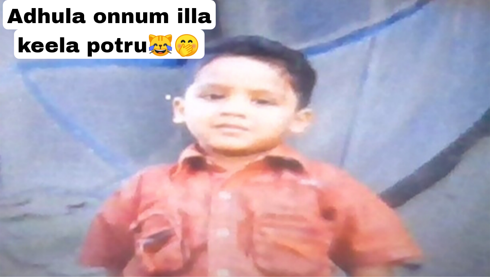

<!DOCTYPE html>
<html lang="en">
<head>
<meta charset="UTF-8">
<meta name="viewport" content="width=device-width, initial-scale=1.0">
<title>A Little Secret 🖤</title>

</head>

<body>

    

        
✦ CONFIDENTIAL ✦

        <h1>Hey youu kannadiii 🖤</h1>

        

            Do you wanna see how much I like you? 🥹❤️
        

        

            I have something special to show you.
            Are you ready to discover the truth? 👀
        

        <button class="yes" onclick="reveal()">
            YES, SHOW ME ❤️
        </button>

        <button class="no" onclick="notReady()">
            NO 🙈
        </button>

        

            YOUR CURIOSITY BROUGHT YOU HERE.
        

    

    

        
✦ THE BIG REVEAL ✦

        <h1>YOU THOUGHT?! 🤡</h1>

        

            

            <h2>ONNUM ILLA DA! 😭</h2>

            

                You really thought there was
                something special here? 😂
            

        

        

            Thanks for your precious time!
             
            Better luck next time. 🤣❤️
        

        <button class="yes" onclick="location.reload()">
            TRY AGAIN 😂
        </button>

        

            PRANK SUCCESSFULLY DELIVERED.
        

    

</body>
</html>
